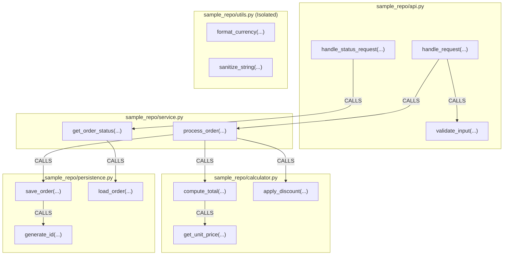

# Pathwise — Intelligent Code Investigation Through Connected Paths

> **Hackathon Track:** Agents That Act on Connected Data

Pathwise is an AI-powered codebase investigation platform that transforms Python source code into a graph of files, functions, and function calls. It allows developers to investigate dependencies, trace multi-hop execution relationships, and understand the potential impact of code changes.

Its defining feature is **evidence-backed reasoning**. Every factual dependency claim is traceable to source-code facts and graph relationships. A built-in **Proof Mode** independently checks whether the graph supports the claims made in an investigation, distinguishing **SUPPORTED**, **UNSUPPORTED**, and **INCONCLUSIVE** results.

## Problem Statement

Understanding code dependencies in a growing codebase is hard:

- **"What will break if I change this function?"** — Manual inspection doesn't scale.
- **"How does data flow from this endpoint to the database?"** — IDE "find references" shows only direct callers, not multi-hop chains.
- **"Can I trust this dependency analysis?"** — LLM-generated answers may hallucinate relationships that don't exist.

Pathwise solves these problems by building a **real dependency graph** from static analysis and providing **verifiable, evidence-backed** answers.

## Target Users

- Developers investigating unfamiliar codebases
- Engineers assessing change impact before refactoring
- Code reviewers understanding dependency chains
- Teams that need trustworthy dependency analysis, not AI guesses

## Core Capabilities

| Capability | Description |
|---|---|
| **Static Python Analysis** | AST-based parser discovers files, functions, classes, and call relationships without executing code |
| **FalkorDB Graph Database** | Stores dependency relationships as a queryable graph with multi-hop traversal |
| **Natural Language Investigation** | Ask questions like "Who calls compute_total?" and get graph-backed answers |
| **Proof Mode** | Independent verification of every claim with SUPPORTED/UNSUPPORTED/INCONCLUSIVE status |
| **Multi-hop Path Finding** | Trace call chains across files: `api.py → service.py → calculator.py` |
| **Evidence Paths** | Every answer includes file paths, line numbers, and graph traversal details |

## Why FalkorDB Is Essential

FalkorDB is **not** a decorative component. It is the authoritative data store and reasoning engine:

1. **Multi-hop traversal** — Variable-length path queries (`[:CALLS*1..N]`) discover indirect dependency chains that no simple lookup can find.
2. **Parameterized Cypher** — All queries use parameterized Cypher for safety and correctness.
3. **Proof Mode verification** — Claims are independently verified by re-querying the graph, not by trusting LLM output.
4. **Repository isolation** — Each repository gets its own graph, preventing cross-contamination.
5. **Idempotent re-indexing** — The graph is cleanly rebuilt on re-index with stale data removal.

Without FalkorDB, Pathwise cannot answer multi-hop dependency questions or verify claims.

---

## Architecture

```
┌──────────────┐     ┌───────────┐     ┌─────────────┐
│  Python Repo │────>│  Parser   │────>│ Graph Store  │
│  (.py files) │     │  (AST)    │     │ (FalkorDB)   │
└──────────────┘     └───────────┘     └──────┬───────┘
                                              │
                     ┌───────────┐     ┌──────▼───────┐
                     │  Verifier │<────│ Investigator │
                     │(Proof Mode)│    │(Query Engine)│
                     └─────┬─────┘     └──────┬───────┘
                           │                  │
                     ┌─────▼──────────────────▼──────┐
                     │        FastAPI Server          │
                     │   /health /investigate /verify │
                     └────────────────────────────────┘
```

**Data Flow:**
1. **Parser** reads `.py` files using Python's `ast` module (never executes code)
2. **Graph Store** ingests parsed functions and calls into FalkorDB
3. **Investigator** converts questions into Cypher queries and retrieves evidence
4. **Verifier** independently re-queries the graph to validate each claim
5. **FastAPI** exposes REST endpoints for all operations

---

## Graph Schema

### Nodes

| Label | Properties | Description |
|---|---|---|
| `Repository` | `repo_id`, `path` | An indexed Python repository |
| `File` | `file_path`, `repo_id` | A Python source file |
| `Function` | `function_id`, `name`, `qualified_name`, `file_path`, `start_line`, `end_line`, `is_method`, `is_async`, `repo_id` | A discovered function or method |

### Relationships

| Pattern | Properties | Description |
|---|---|---|
| `(:Repository)-[:CONTAINS]->(:File)` | — | Repository contains a file |
| `(:File)-[:CONTAINS]->(:Function)` | — | File contains a function |
| `(:Function)-[:CALLS]->(:Function)` | `call_line` | One function calls another |

### Function ID Format

```
{repo_id}::{relative/path.py}::{qualified_name}
```

Example: `a1b2c3d4e5f6::service.py::process_order`

### Sample Call Graph (`sample_repo/`)
Below is the dependency graph ingested into FalkorDB for the sample repository, showing cross-file call chains and isolated functions:


---

## Cypher Queries

### Direct callers of a function
```cypher
MATCH (caller:Function)-[c:CALLS]->(target:Function {function_id: $fid, repo_id: $repo_id})
RETURN caller.function_id, caller.name, caller.qualified_name,
       caller.file_path, caller.start_line, c.call_line
```

### Direct callees of a function
```cypher
MATCH (source:Function {function_id: $fid, repo_id: $repo_id})-[c:CALLS]->(callee:Function)
RETURN callee.function_id, callee.name, callee.qualified_name,
       callee.file_path, callee.start_line, c.call_line
```

### Multi-hop caller traversal (bounded)
```cypher
MATCH path = (root:Function)-[:CALLS*1..5]->(target:Function {function_id: $fid, repo_id: $repo_id})
WHERE root.repo_id = $repo_id
RETURN [n IN nodes(path) | [n.function_id, n.name, n.qualified_name, n.file_path, n.start_line]]
```

### Call chain between two functions
```cypher
MATCH path = (src:Function {function_id: $src_id, repo_id: $repo_id})
             -[:CALLS*1..5]->
             (dst:Function {function_id: $dst_id, repo_id: $repo_id})
RETURN [n IN nodes(path) | [n.function_id, n.name, n.qualified_name, n.file_path, n.start_line]]
```

### Edge existence check
```cypher
MATCH (a:Function {function_id: $caller_id, repo_id: $repo_id})
      -[:CALLS]->
      (b:Function {function_id: $callee_id, repo_id: $repo_id})
RETURN count(*) AS cnt
```

All queries use **parameterized Cypher** — no string interpolation of user input.

---

## Proof Mode

Proof Mode is Pathwise's defining feature. It independently verifies every claim against the authoritative graph.

### Verification Statuses

| Status | Meaning |
|---|---|
| **SUPPORTED** | The graph contains the required nodes and relationships |
| **UNSUPPORTED** | Both nodes exist but the claimed relationship does not |
| **INCONCLUSIVE** | A node is missing, indexing may be incomplete, or the system cannot safely decide |

### What Proof Mode verifies:
- Direct CALLS edges between functions
- Multi-hop call chains (validates each edge in the path)
- Node existence in the correct repository

### What Proof Mode cannot prove:
- Runtime behavior (dynamic dispatch, monkey-patching)
- That a code change **will** cause a failure
- Relationships involving unresolved calls or dynamic imports
- Completeness — unindexed code may contain additional relationships

---

## Installation & Setup

### Prerequisites
- Python 3.11+
- Docker (for FalkorDB)

### Quick Start

```powershell
# 1. Clone the repository
git clone https://github.com/PathwiseAI/pathwise.git
cd pathwise

# 2. Install dependencies
pip install -r requirements.txt

# 3. Start FalkorDB
docker-compose up -d

# 4. Copy environment config
copy .env.example .env

# 5. Run the demo
python scripts/demo.py

# 6. Or start the API server
python -m app.main
# Server runs at http://localhost:8000
# API docs at http://localhost:8000/docs
```

### Configuration (.env)

```ini
FALKORDB_HOST=localhost
FALKORDB_PORT=6379
PATHWISE_PORT=8000
ALLOWED_ROOT=.
```

---

## Usage

### CLI Demo

```powershell
# Full end-to-end demo (requires FalkorDB)
python scripts/demo.py

# API demo (requires server running)
python scripts/demo.py --api
```

### API Endpoints

| Method | Path | Description |
|---|---|---|
| GET | `/health` | Health check with FalkorDB status |
| POST | `/api/repositories/index` | Index a Python repository |
| GET | `/api/repositories` | List indexed repositories |
| GET | `/api/repositories/{id}/functions` | List discovered functions |
| POST | `/api/investigate` | Ask a question about the codebase |
| POST | `/api/verify` | Verify a specific dependency claim |

### Example Investigation

```bash
# Index a repository
curl -X POST http://localhost:8000/api/repositories/index \
  -H "Content-Type: application/json" \
  -d '{"path": "./sample_repo"}'

# Ask a question
curl -X POST http://localhost:8000/api/investigate \
  -H "Content-Type: application/json" \
  -d '{
    "repository_id": "<repo_id>",
    "question": "Who calls compute_total?"
  }'
```

### Supported Question Patterns

| Pattern | Intent | Example |
|---|---|---|
| Who/what calls X? | Find callers | "Who calls compute_total?" |
| What does X call? | Find callees | "What does process_order call?" |
| Impact of changing X | Find impact | "What is the impact of changing get_unit_price?" |
| Path from X to Y | Find path | "Path from handle_request to save_order" |
| Verify X calls Y | Verify claim | "Verify that process_order calls compute_total" |

---

## Example Output

### Investigation: "Who calls compute_total?"

```json
{
  "intent": "find_callers",
  "answer": "Function `compute_total` is directly called by: `process_order` (service.py:8).",
  "claims": [
    {
      "subject": "..::service.py::process_order",
      "predicate": "CALLS",
      "target": "..::calculator.py::compute_total",
      "category": "graph_fact"
    }
  ],
  "proof_records": [
    {
      "status": "SUPPORTED",
      "reason": "Direct CALLS relationship confirmed: 'process_order' -> 'compute_total'",
      "evidence_inspected": ["node_check:...", "edge_check:CALLS:..."]
    }
  ]
}
```

---

## Testing

```powershell
# Run unit tests (no FalkorDB needed)
python -m pytest tests/unit/ -v

# Run integration tests (requires FalkorDB on localhost:6379)
python -m pytest tests/integration/ -v -m integration

# Run API tests (requires FalkorDB)
python -m pytest tests/integration/test_api.py -v

# Run all tests
python -m pytest -v
```

---

## Security Notes

- **No code execution** — Parser uses `ast.parse()` only, never imports or runs analyzed code
- **Path validation** — Repository paths must be within the configured `ALLOWED_ROOT`
- **Parameterized Cypher** — All queries use parameters, no string interpolation
- **No arbitrary Cypher** — Users cannot execute raw Cypher queries
- **Symlink safety** — Symlinks escaping the repository root are rejected
- **Size limits** — File size, file count, and traversal depth are bounded

## Known Limitations

1. **Python only** — Currently parses Python source files; other languages are not supported
2. **Static analysis** — Cannot resolve dynamic dispatch, monkey-patching, `getattr()` calls, or runtime-generated function calls
3. **Conservative resolution** — Some valid calls may be reported as unresolved rather than guessed incorrectly
4. **Import resolution** — Only resolves imports from within the analyzed repository; third-party library calls are not tracked
5. **No LLM integration** — Current version uses deterministic intent detection; natural language understanding is pattern-based
6. **Single-user** — No authentication or multi-tenant isolation
7. **Not production-hardened** — Intended for development/demo use, not internet-facing deployment

## Demo

> 📹 **Demo video:** [Watch 3-minute Demo](https://youtu.be/uydXysupKpo)

> 🕸️ **FalkorDB Visual Graph Walkthrough:** [Watch Visual Graph Demo](https://youtu.be/ib61_Z_SgFI)

> 🌐 **Deployment** Local FalkorDB instance via Docker

The demo script (`scripts/demo.py`) demonstrates the complete workflow:
1. Connect to FalkorDB
2. Parse and index the sample repository
3. Discover files and functions
4. Investigate callers, callees, impact, and paths
5. Run Proof Mode verification
6. Show SUPPORTED, UNSUPPORTED, and INCONCLUSIVE results

---

## License

MIT
